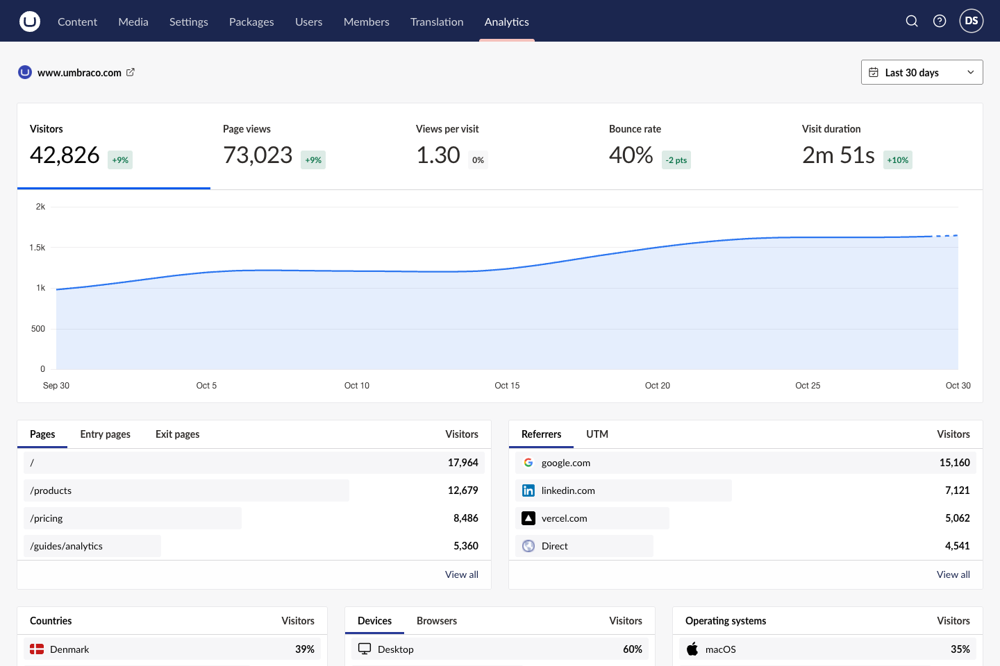
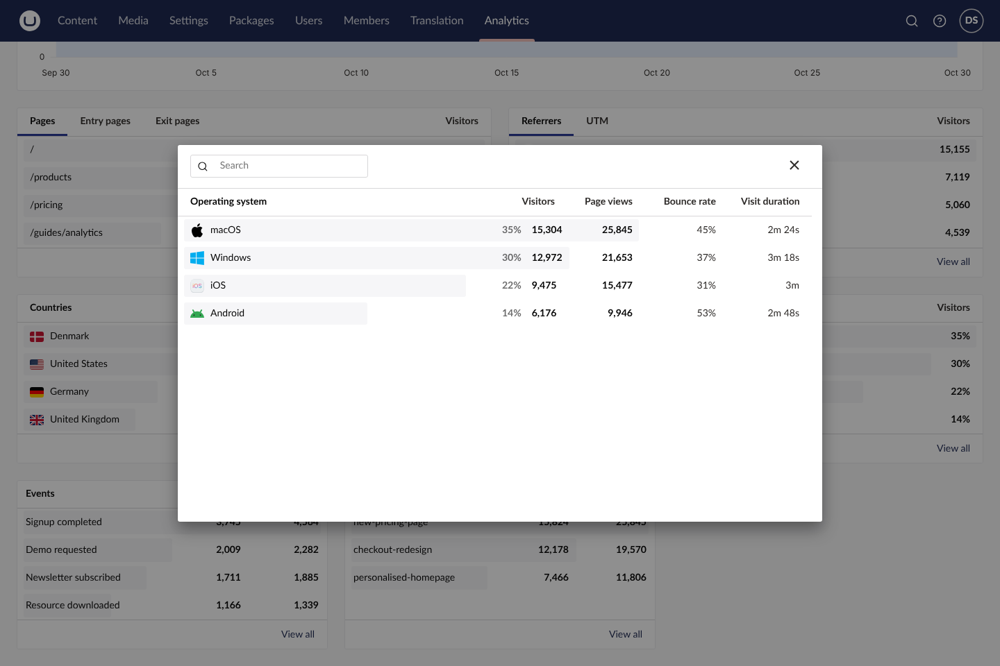
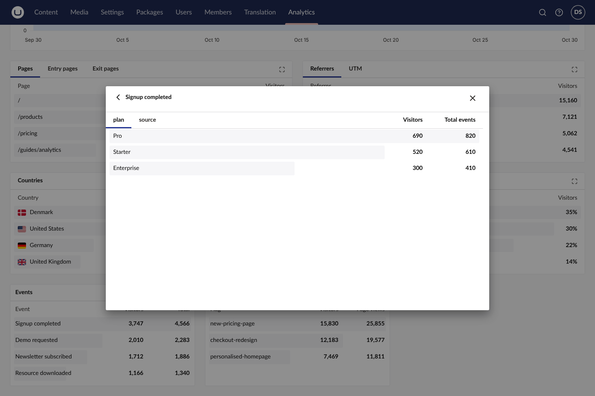
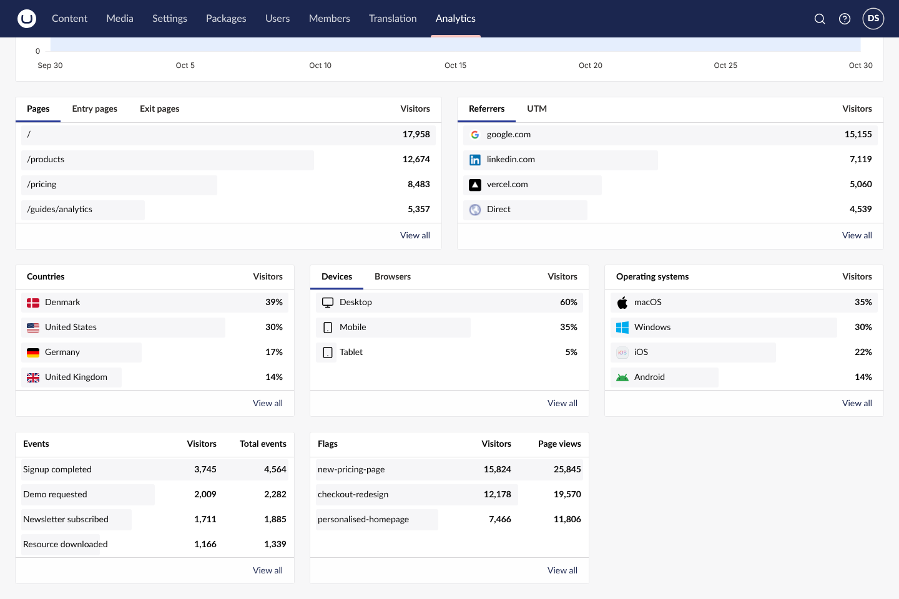
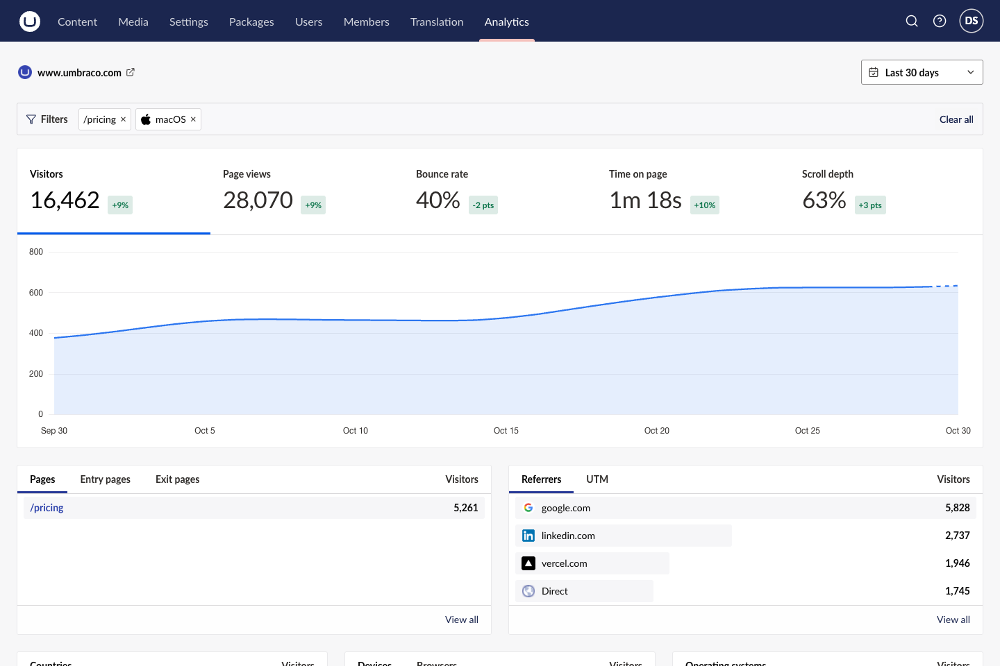

The Analytics section shows one dashboard per connection. This page explains what every part of it means. For setup, see the [quickstart](/quickstart). For page-level reports, see [document analytics](/guides/document-analytics).

## Dashboard controls

Two controls in the header shape every report below them.

| Control | What it does |
| --- | --- |
| **Analytics connection** | Switches between configured connections when more than one exists. Every metric, breakdown, and filter is scoped to the selected connection. |
| **Date range** | Pick a preset (Last 24 hours, Last 7 days, Last 30 days, Last 90 days, or Last 12 months) or set a custom range. The default is 30 days, changed with `DefaultRangeDays`. |

The range also decides how history is grouped. A single day is grouped hourly, up to a month daily, up to a quarter weekly, and anything longer monthly.

## Metrics and history

**Visitors** and **Page views** always sit at the top of the dashboard. Visitors counts the distinct people who arrived in the selected range. Page views counts the pages they loaded.

When the provider reports how visits went, engagement metrics join them. Today that is Plausible:

| Metric | Shown | Meaning |
| --- | --- | --- |
| **Views per visit** | Site-wide | Average number of pages loaded in one visit. |
| **Bounce rate** | Always | Share of visits that viewed one page and left. Lower is better. |
| **Visit duration** | Site-wide | Average length of a visit. |
| **Time on page** | For a page | Average time spent on the page per visit. |
| **Scroll depth** | For a page | How far down the page visitors scrolled, on average. |

"For a page" means the document workspace, or the dashboard filtered to one page. Engagement is left out while an event filter is active, because the report then counts conversions rather than visits.

Each metric is always compared against the preceding period of the same length. There is no toggle for it. The badge shows a signed percentage such as `+12%`, and reads in full as "12% more visitors than the previous 30 days". Rates such as bounce rate change in percentage points, shown as `-3 pts`. The badge is green when the change is an improvement, so a falling bounce rate is green. When the previous period has no data, the badge disappears instead of inventing a change.

Select a metric to plot it over time. The chart uses the interval implied by the range, and draws the final segment as in-progress while the current period is still running.

## Breakdowns

Breakdowns rank the pages, sources, places, and devices behind those totals. Each card lists the top entries with a proportional bar and the metric value. **View all** opens a searchable dialog with the complete list.

| Card | Shows |
| --- | --- |
| **Pages** | The most-visited request paths. When the provider reports how visits start and end, **Entry pages** and **Exit pages** tabs list the pages visits started and ended on. (Hidden on a document report, which is already scoped to one page.) |
| **Acquisition** | Where traffic came from. A **Referrers** tab lists the sites and sources that sent visitors; when the connection supports UTM reporting, a **UTM** tab adds sub-tabs for **Source**, **Medium**, **Campaign**, **Term**, and **Content** from tagged marketing links. |
| **Countries** | Visitors grouped by country. |
| **Audience** | A tabbed card covering **Devices** and **Browsers**. |
| **Operating systems** | Visitors grouped by operating system. |

On a provider with engagement metrics, the **View all** dialog adds columns beside visitors and page views: bounce rate, time on page, and scroll depth for pages, and bounce rate and visit duration for sources, places, and devices. A dash means the provider had no value for that row. On a narrow screen the dialog keeps only the traffic columns.

The **UTM** tab appears only when the selected connection can report those dimensions, which depends on the provider and its plan. On a plan-limited connection the card says so, rather than showing an empty tab.

## Events

When the provider records custom events, the dashboard adds an **Events** panel listing each event and its total. **View all events** opens the full searchable list, and opening an event drills into its properties.

A property drill-down splits one event by a recorded property, for example which URLs an outbound-link event pointed at. On Plausible, name the properties you want to explore in the connection's event-property settings. See the [Plausible reference](/providers/plausible#event-properties).

## Feature flags

On a Vercel connection that reports feature flags, a **Flags** panel lists each flag with its totals, and **View all flags** opens the complete list. Plausible has no feature flags, so the panel does not appear on a Plausible connection.

## Filtering and drill-downs

Any breakdown row can become a filter. Click the row to apply it, and click it again to remove it. The filter narrows every report on the dashboard, for example to visitors from one country, or traffic from one referrer. Pages and referrers also show an open icon on hover, which opens the page or site in a new tab. In the **Events** panel, clicking an event opens its details instead, so its filter sits behind the filter icon on hover.

Active filters appear as a **Filters** group beneath the header. Remove one from its chip, or choose **Clear all** to go back to the unfiltered view. The URL carries the filters, the date range, and the selected breakdown tabs, so you can bookmark or share a filtered view.

:::note[Provider differences are expected]
The interface adapts to what each provider supports instead of showing errors. Vercel cannot apply an event or event-property filter to a global report, and cannot change a breakdown's ordering metric. Plausible does both, but has no feature flags. A hidden panel means the provider does not offer that capability, not that the connection failed. The [Vercel](/providers/vercel#capabilities) and [Plausible](/providers/plausible#capabilities) references list the exact per-provider capabilities.
:::

## Reports on a document

The same metrics, history, and breakdowns appear in the Analytics workspace on a mapped document, scoped to that document's published route. The document view adds an **Include child paths** toggle, switching between the single page and the whole section beneath it. See [document analytics](/guides/document-analytics) for mapping and permissions.
